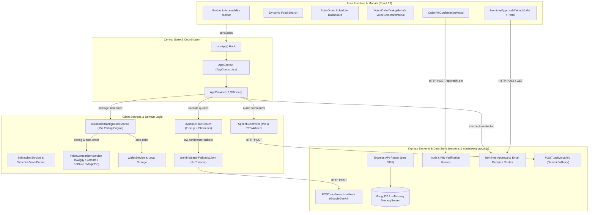

# AutoFeast AI – Architectural Trace & Codebase Specification

This document provides a verified, deep-dive architectural trace of the AutoFeast AI application codebase. It is generated through AST/knowledge-graph analysis (`graphify-out/graph.json`) verified against the TypeScript and JavaScript source files.

---

## 1. Executive Architectural Summary & True Application Hubs

When excluding external vendor bundles and WebAssembly runtimes (`public/wasm/*.mjs`, `onnxruntime`, `node_modules`, and build scripts), the graph analysis reveals the true architectural core of AutoFeast:

| Rank | Symbol / Module | File Path | Degree / Connections | Role in System |
|---|---|---|---|---|
| **1** | `AppContext.tsx` | [`src/context/AppContext.tsx`](file:///c:/Users/D%20KAVINKUMAR/Desktop/AutoFeast/src/context/AppContext.tsx) | **121** | Global application state hub, event coordinator, and modal manager |
| **2** | `Language` | [`src/types.ts`](file:///c:/Users/D%20KAVINKUMAR/Desktop/AutoFeast/src/types.ts#L1-L3) | **88** | Core domain type for trilingual localization (`en`, `ta`, `hi`) |
| **3** | `useApp()` | [`src/context/AppContext.tsx`](file:///c:/Users/D%20KAVINKUMAR/Desktop/AutoFeast/src/context/AppContext.tsx#L2892-L2896) | **86** | Primary consumption hook across all UI components and modals |
| **4** | `types.ts` | [`src/types.ts`](file:///c:/Users/D%20KAVINKUMAR/Desktop/AutoFeast/src/types.ts) | **79** | Central contract repository for schedules, bills, orders, and nominees |
| **5** | `server.js` | [`server.js`](file:///c:/Users/D%20KAVINKUMAR/Desktop/AutoFeast/server.js) | **73** | Express + MongoDB backend with auth, nominee, cart, NLU, and fallback routes |
| **6** | `App.tsx` | [`src/App.tsx`](file:///c:/Users/D%20KAVINKUMAR/Desktop/AutoFeast/src/App.tsx) | **72** | Root layout, routing container, and top-level modal orchestrator |
| **7** | `AppProvider()` | [`src/context/AppContext.tsx`](file:///c:/Users/D%20KAVINKUMAR/Desktop/AutoFeast/src/context/AppContext.tsx#L215-L2890) | **70** | Root state provider implementing `AppContextType` |
| **8** | `SpeechControllerManager` | [`src/services/speechController.ts`](file:///c:/Users/D%20KAVINKUMAR/Desktop/AutoFeast/src/services/speechController.ts#L63-L1405) | **63** | Singleton audio arbiter managing microphone access, STT, and TTS turns |
| **9** | `FoodItem` | [`src/types.ts`](file:///c:/Users/D%20KAVINKUMAR/Desktop/AutoFeast/src/types.ts#L100-L135) | **61** | Core entity schema representing catalog dishes, pricing, and restaurant bindings |
| **10** | `sttMatcherService.ts` | [`src/services/sttMatcherService.ts`](file:///c:/Users/D%20KAVINKUMAR/Desktop/AutoFeast/src/services/sttMatcherService.ts) | **55** | Phonetic, regex, and multilingual speech intent matcher |
| **11** | `SearchGuidedOrderModal.tsx` | [`src/components/SearchGuidedOrderModal.tsx`](file:///c:/Users/D%20KAVINKUMAR/Desktop/AutoFeast/src/components/SearchGuidedOrderModal.tsx) | **52** | Multi-step ordering modal (variety → restaurant → timing) |
| **12** | `ScheduleCheckoutModal.tsx` | [`src/components/ScheduleCheckoutModal.tsx`](file:///c:/Users/D%20KAVINKUMAR/Desktop/AutoFeast/src/components/ScheduleCheckoutModal.tsx) | **50** | Schedule confirmation, date overrides, bill summary, and PIN trigger |
| **13** | `VoiceCommandModal.tsx` | [`src/components/VoiceCommandModal.tsx`](file:///c:/Users/D%20KAVINKUMAR/Desktop/AutoFeast/src/components/VoiceCommandModal.tsx) | **43** | Global speech listening modal with transcript feedback |
| **14** | `scheduleVoiceParser.ts` | [`src/services/scheduleVoiceParser.ts`](file:///c:/Users/D%20KAVINKUMAR/Desktop/AutoFeast/src/services/scheduleVoiceParser.ts) | **43** | Local NLP parser translating spoken dates, recurring frequencies, and times |
| **15** | `AutoOrderScheduler.tsx` | [`src/components/AutoOrderScheduler.tsx`](file:///c:/Users/D%20KAVINKUMAR/Desktop/AutoFeast/src/components/AutoOrderScheduler.tsx) | **36** | UI management dashboard for recurring schedules and date overrides |

---

## 2. High-Level System Architecture Diagram



---

## 3. Deep-Dive Architectural Traces

### Trace 1: Application State Architecture (`useApp()`, `AppContext.tsx`, `AppProvider`)
- **Definition & Export**:
  - `AppContextType` is defined in [`src/context/AppContext.tsx#L26-L213`](file:///c:/Users/D%20KAVINKUMAR/Desktop/AutoFeast/src/context/AppContext.tsx#L26-L213).
  - `AppContext` is created via `createContext<AppContextType | undefined>(undefined)` in [`src/context/AppContext.tsx#L214`](file:///c:/Users/D%20KAVINKUMAR/Desktop/AutoFeast/src/context/AppContext.tsx#L214).
  - `AppProvider` is implemented in [`src/context/AppContext.tsx#L215-L2890`](file:///c:/Users/D%20KAVINKUMAR/Desktop/AutoFeast/src/context/AppContext.tsx#L215-L2890).
  - `useApp()` is exported at [`src/context/AppContext.tsx#L2892-L2896`](file:///c:/Users/D%20KAVINKUMAR/Desktop/AutoFeast/src/context/AppContext.tsx#L2892-L2896). It verifies context presence and throws `'useApp must be used within an AppProvider'` if missing.
- **Key State Categories Exposed**:
  1. *App Lifecycle & Localization*: `entryStep`, `language`, `t()`, `accessibilitySettings`, `activeView`.
  2. *Authentication & Daily Limits*: `currentUser`, `isAuthenticated`, `isFaceIdSupported`, `dailyOrderCount` (caps at 6 orders/day), `renewLimitWithPIN()`, `renewLimitWithNominee()`.
  3. *Location*: `userLocation` (GPS coordinates, address), `detectGPSLocation()`, `setManualUserLocation()`.
  4. *Dynamic Food Search*: `searchQuery`, `selectedLocation`, `selectedCuisine`, `vegOnly`, `searchResult`, `executeSearch()`.
  5. *Audio & Voice Prompts*: `autoVoicePromptEnabled`, `speakText()`, `processNaturalLanguageVoiceCommand()`.
  6. *Digital Wallet*: `walletBalance`, `isWalletRevealed`, `rechargeWallet()`, `walletTransactions`.
  7. *Orders & Schedules*: `schedules`, `overrides`, `saveSchedule()`, `deleteSchedule()`, `executeScheduleNow()`, `orderHistory`.
  8. *Security PIN Verification*: `pendingPinVerification`, `isOrderPinModalOpen`, `confirmPendingPinAction()`.
  9. *Nominee Safeguards*: `checkIsItemRestrictedByNominee()`, `handleNomineeRestrictedInterception()`, `pendingNomineeApprovals`, `waitingNomineeApproval`.
  10. *Cart*: `cart`, `addToCart()`, `removeFromCart()`, `updateCartQuantity()`, `clearCart()`.

---

### Trace 2: Auto-Order Scheduling Subsystem
- **Components & Entry Points**:
  - [`src/components/AutoOrderScheduler.tsx`](file:///c:/Users/D%20KAVINKUMAR/Desktop/AutoFeast/src/components/AutoOrderScheduler.tsx): Main interactive schedule dashboard allowing creation, modification, overrides, and manual instant execution.
  - [`src/components/ScheduleCheckoutModal.tsx`](file:///c:/Users/D%20KAVINKUMAR/Desktop/AutoFeast/src/components/ScheduleCheckoutModal.tsx): Guided modal for reviewing schedules, configuring duration (1 Week, 1 Month, 3 Months, Custom), selecting specific days of week, and reviewing monthly itemized GST bills.
  - [`src/components/ScheduleBill.tsx`](file:///c:/Users/D%20KAVINKUMAR/Desktop/AutoFeast/src/components/ScheduleBill.tsx): Itemized occurrence and bill calculator.
  - [`src/services/scheduleVoiceParser.ts`](file:///c:/Users/D%20KAVINKUMAR/Desktop/AutoFeast/src/services/scheduleVoiceParser.ts): Local NLP parser extracting delivery times, duration, frequencies, and days of week from spoken commands.
- **Complete End-to-End Workflow**:
  1. **Schedule Assembly**: The user chooses food item, delivery window, and recurrence pattern (Daily, Weekly, Once, Custom).
  2. **Nominee Restriction Gate**: In `AppContext.saveSchedule()` ([`src/context/AppContext.tsx#L2403-L2447`](file:///c:/Users/D%20KAVINKUMAR/Desktop/AutoFeast/src/context/AppContext.tsx#L2403-L2447)), the system checks:
     - `checkDailyOrderLimitReached()`: Enforces daily maximum.
     - `checkIsItemRestrictedByNominee(s.foodItemId, s.foodItemName)`: If restricted and no prior nominee approval token exists, schedule creation is halted, and `handleNomineeRestrictedInterception()` is invoked.
  3. **Security PIN Verification**:
     - If not restricted (or already approved), `saveSchedule()` checks for a valid `verificationToken`.
     - If no token, it sets `pendingPinVerification = { type: 'save_schedule', schedule: ... }` and opens `OrderPinConfirmationModal` ([`src/context/AppContext.tsx#L2460-L2464`](file:///c:/Users/D%20KAVINKUMAR/Desktop/AutoFeast/src/context/AppContext.tsx#L2460-L2464)).
  4. **Persistence**:
     - Upon PIN confirmation (`confirmPendingPinAction` in [`src/context/AppContext.tsx#L2650-L2700`](file:///c:/Users/D%20KAVINKUMAR/Desktop/AutoFeast/src/context/AppContext.tsx#L2650-L2700)), `executeActualSaveSchedule` delegates to `AutoOrderBackgroundService.saveSchedule(safeSchedule)` ([`src/services/autoOrderBackgroundService.ts#L125-L160`](file:///c:/Users/D%20KAVINKUMAR/Desktop/AutoFeast/src/services/autoOrderBackgroundService.ts#L125-L160)), persisting to `localStorage` (`smart_food_auto_schedules`).
     - Server sync: Optionally syncs with `POST /api/schedules` in [`server.js#L3386`](file:///c:/Users/D%20KAVINKUMAR/Desktop/AutoFeast/server.js#L3386).
  5. **Background Execution**:
     - `AutoOrderBackgroundService.startService()` runs an active polling loop every 15 seconds (`setInterval` in [`src/services/autoOrderBackgroundService.ts#L525-L531`](file:///c:/Users/D%20KAVINKUMAR/Desktop/AutoFeast/src/services/autoOrderBackgroundService.ts#L525-L531)).
     - `checkSchedules()` ([`src/services/autoOrderBackgroundService.ts#L437-L520`](file:///c:/Users/D%20KAVINKUMAR/Desktop/AutoFeast/src/services/autoOrderBackgroundService.ts#L437-L520)) evaluates:
       - Start and End date bounds.
       - Recurrence frequency and day-of-week matching.
       - Daily overrides (`isSkipped` or time shifts).
       - **5-Minute Pre-Order Voice Confirmation**: 5 minutes before trigger, broadcasts to pre-order listeners.
       - **Trigger Time Matching**: When current time matches schedule target time:
         - Checks daily order limit.
         - Executes order via `executeScheduleNow()`: automatically compares prices across Swiggy, Zomato, EatSure, and MagicPin via `PriceComparisonService.getLivePrices()`, debits the wallet via `WalletService.debit()`, records the transaction in audit logs, and adds an entry to `smart_food_order_history`.

---

### Trace 3: Voice Ordering Subsystem
- **Components & Architecture**:
  - [`src/components/VoiceOrderDialogModal.tsx`](file:///c:/Users/D%20KAVINKUMAR/Desktop/AutoFeast/src/components/VoiceOrderDialogModal.tsx): Trilingual dialog modal guiding the user through Order Now vs. Schedule, item customization, bill confirmation, and PIN verification.
  - [`src/services/speechController.ts`](file:///c:/Users/D%20KAVINKUMAR/Desktop/AutoFeast/src/services/speechController.ts): Low-level singleton managing Web Speech API (`SpeechRecognition` & `SpeechSynthesis`). Enforces strict turn-taking (never listens while speaking).
  - [`src/services/sttMatcherService.ts`](file:///c:/Users/D%20KAVINKUMAR/Desktop/AutoFeast/src/services/sttMatcherService.ts): Multi-engine intent parser (Regex, normalized Indic numerals, phonetic strings).
  - [`src/services/voiceIntentRouter.ts`](file:///c:/Users/D%20KAVINKUMAR/Desktop/AutoFeast/src/services/voiceIntentRouter.ts): Decision router classifying transcripts into actions (`order_now`, `schedule`, `confirm`, `cancel`, `repeat`).
- **Complete Voice Order Flow**:
  1. **Microphone Acquisition**:
     - `SpeechController.requestMic({ caller: 'voice_order_dialog', lang, onResult, onError })` requests mic ownership ([`src/components/VoiceOrderDialogModal.tsx#L275`](file:///c:/Users/D%20KAVINKUMAR/Desktop/AutoFeast/src/components/VoiceOrderDialogModal.tsx#L275)).
  2. **Speech-to-Text (STT)**:
     - Browser Web Speech STT captures audio and yields interim and final transcripts.
     - Transcripts are normalized (Indic digits mapped to 0–9, filler words stripped).
  3. **Intent & Catalog Matching**:
     - In general voice search, `processNaturalLanguageVoiceCommand()` ([`src/context/AppContext.tsx#L1732-L2000`](file:///c:/Users/D%20KAVINKUMAR/Desktop/AutoFeast/src/context/AppContext.tsx#L1732-L2000)) invokes `voiceCommandParser.ts` and `SttMatcherService.matchFoodItem()` to resolve dish names, quantities, and restaurants against `INDIAN_FOOD_CATALOG`.
     - In `VoiceOrderDialogModal`, `voiceIntentRouter.ts` handles modal stage navigation (Order Now vs Schedule, time parsing via `parseSpokenTimeTo24Hr`).
  4. **Text-to-Speech (TTS) Prompts**:
     - System prompts are spoken via `speakText(promptMsg, onEnd, language)` in [`src/context/AppContext.tsx#L2718-L2770`](file:///c:/Users/D%20KAVINKUMAR/Desktop/AutoFeast/src/context/AppContext.tsx#L2718-L2770).
     - Microphone is paused while speaking to prevent self-trigger feedback loops.
  5. **Order Creation**:
     - For *Order Now*: Calls `placeInstantOrderConfirmed()` → `placeInstantOrder(item)` ([`src/components/VoiceOrderDialogModal.tsx#L815-L820`](file:///c:/Users/D%20KAVINKUMAR/Desktop/AutoFeast/src/components/VoiceOrderDialogModal.tsx#L815-L820)) → debits wallet, creates live tracking record, opens `LiveOrderTrackingView`.
     - For *Schedule*: Calls `finalizeAutoSchedule()` → `saveSchedule(newSchedule)` ([`src/components/VoiceOrderDialogModal.tsx#L796`](file:///c:/Users/D%20KAVINKUMAR/Desktop/AutoFeast/src/components/VoiceOrderDialogModal.tsx#L796)) → initiates PIN verification / background scheduler.

---

### Trace 4: Nominee Approval, Interception & Security Pipeline
- **Restricted-Item Detection**:
  - Implemented in [`src/context/AppContext.tsx#L835-L846`](file:///c:/Users/D%20KAVINKUMAR/Desktop/AutoFeast/src/context/AppContext.tsx#L835-L846) via `checkIsItemRestrictedByNominee(foodId, foodName)`.
  - Reads `currentUser.restrictedFoodIds` (defaults to canonical `chaat-pani-puri`).
  - Calls `isFoodItemRestricted()` from [`src/utils/nomineeRestrictedItems.ts`](file:///c:/Users/D%20KAVINKUMAR/Desktop/AutoFeast/src/utils/nomineeRestrictedItems.ts).
- **Interception & Request Creation**:
  - When an order or schedule includes a restricted dish, `handleNomineeRestrictedInterception()` triggers ([`src/context/AppContext.tsx#L862-L955`](file:///c:/Users/D%20KAVINKUMAR/Desktop/AutoFeast/src/context/AppContext.tsx#L862-L955)).
  - Sends a `POST /api/nominee/approval-requests` request to the backend ([`server.js#L2398-L2480`](file:///c:/Users/D%20KAVINKUMAR/Desktop/AutoFeast/server.js#L2398-L2480)).
  - Generates a crypto-secure `emailToken` (SHA-256 hashed in database: `emailTokenHash`).
  - Sets appropriate TTL: **30 minutes** for instant orders; **24 hours** for scheduled orders ([`nomineeApproval.js#L8-L9`](file:///c:/Users/D%20KAVINKUMAR/Desktop/AutoFeast/nomineeApproval.js#L8-L9)).
  - Dispatches an email to the nominee via Nodemailer with direct decision links (`/api/nominee/approvals/respond-email?token=...&decision=approve|deny`).
  - Opens `NomineeApprovalWaitingModal` in UI ([`src/components/NomineeApprovalWaitingModal.tsx`](file:///c:/Users/D%20KAVINKUMAR/Desktop/AutoFeast/src/components/NomineeApprovalWaitingModal.tsx)) with a 3-second live status polling timer (`GET /api/nominee/approval-requests/:id/status`).
- **Two Decision Paths**:
  1. *Email Decision Path*:
     - Nominee clicks email link.
     - Handled in [`nomineeApproval.js#L140-L240`](file:///c:/Users/D%20KAVINKUMAR/Desktop/AutoFeast/nomineeApproval.js#L140-L240).
     - Resolves pending request by `emailTokenHash`, updates status to `approved` or `denied`, invalidates token, and displays an HTML response page.
  2. *Website Decision Path*:
     - Nominee visits Nominee Portal (`NomineePortalPage.tsx`) or enters PIN directly on website.
     - Endpoint `POST /api/nominee/approval-requests/:id/respond` ([`server.js#L2660-L2705`](file:///c:/Users/D%20KAVINKUMAR/Desktop/AutoFeast/server.js#L2660-L2705)) verifies the nominee PIN against `user.nomineePinHash` using `bcrypt.compare`.
     - Upon valid PIN, updates status to `approved` or `denied`.
- **Order Execution Following Approval**:
  - Polling modal detects `status === 'approved'`, triggers `handleNomineeApprovalApproved()`, stores single-use approval token, and executes the order or schedule without further interception.

---

### Trace 5: Cross-Feature Integration in `useApp()`

`useApp()` functions as the central clearinghouse linking scheduling, voice ordering, and nominee approval:

```
[Voice Order Modal / Voice Command]
          │ (Spoken item / schedule request)
          ▼
    [AppContext.tsx]
          │
          ├──> 1. Daily Limit Check: checkDailyOrderLimitReached() (Max 6)
          │
          ├──> 2. Nominee Security Gate: checkIsItemRestrictedByNominee()
          │          │
          │          ├── If restricted: handleNomineeRestrictedInterception()
          │          │      └─► Dispatches email token + opens WaitingModal
          │          │
          │          └── If approved / safe: proceeds
          │
          ├──> 3. Security PIN Verification: setPendingPinVerification()
          │          │
          │          └─► Opens OrderPinConfirmationModal
          │
          └──> 4. Execution Dispatch:
                     ├─ Instant Order  ──► placeInstantOrder() ──► LiveOrderTrackingView
                     └─ Auto Schedule  ──► AutoOrderBackgroundService.saveSchedule()
```

Every feature is funnelled through the same verification checkpoints in `AppContext.tsx`, ensuring that voice orders cannot bypass nominee restrictions, schedules cannot bypass PIN confirmation, and daily limits are enforced globally.

---

### Trace 6: Import Cycles Analysis (`VoiceOrderDialogModal` ↔ `AppContext` ↔ `ScheduleBill`)

#### The Exact Import Chain
Graph analysis and code inspection confirm two tight dependency cycles:

1. **Direct 2-File Cycle**:
   ```
   src/context/AppContext.tsx
     └─ imports { parseSpokenTimeTo24Hr } from '../components/VoiceOrderDialogModal' (Line 14)
   src/components/VoiceOrderDialogModal.tsx
     └─ imports { useApp } from '../context/AppContext' (Line 13)
   ```

2. **Transitive 3-File Cycle**:
   ```
   src/components/ScheduleBill.tsx
     └─ imports { useApp } from '../context/AppContext' (Line 3)
   src/context/AppContext.tsx
     └─ imports { parseSpokenTimeTo24Hr } from '../components/VoiceOrderDialogModal' (Line 14)
   src/components/VoiceOrderDialogModal.tsx
     └─ imports { ScheduleBill } from './ScheduleBill' (Line 10)
   ```

#### Concrete Risks of This Coupling
1. **Module Initialization Race Conditions**: Because `AppContext.tsx` executes before `VoiceOrderDialogModal.tsx` is completely resolved, any top-level variable or closure reference in `parseSpokenTimeTo24Hr` risks executing against `undefined`.
2. **Bundle Splitting & Code Bloat**: `VoiceOrderDialogModal.tsx` is a large React component (1,684 lines) with child modals and icons. Because the core `AppContext.tsx` imports it statically, the entire voice modal bundle is pulled into the initial root chunk, preventing code-splitting.
3. **Unit Test Fragility**: Isolated unit testing of `AppContext` or pure parsers requires mocking the UI tree of `VoiceOrderDialogModal`.

#### Recommended Refactoring (Recommendations Only — Not Applied)
1. **Extract Pure Time Parser**:
   - Move `parseSpokenTimeTo24Hr(text: string)` out of `src/components/VoiceOrderDialogModal.tsx` into [`src/utils/timeVoiceParser.ts`](file:///c:/Users/D%20KAVINKUMAR/Desktop/AutoFeast/src/utils/timeVoiceParser.ts) or [`src/utils/scheduleCalculator.ts`](file:///c:/Users/D%20KAVINKUMAR/Desktop/AutoFeast/src/utils/scheduleCalculator.ts).
   - Both `AppContext.tsx` and `VoiceOrderDialogModal.tsx` should import from that pure utility.
2. **Decouple `ScheduleBill.tsx`**:
   - Instead of `ScheduleBill.tsx` importing `useApp()` directly, pass `language`, `t`, and `currencySymbol` as props (`ScheduleBillProps`). This converts `ScheduleBill` into a pure presentational component with zero context dependency.

---

### Trace 7: Dynamic Search & Fallback Readiness

#### Current Dynamic Search Entry Points
1. **Typed Search Entry Point**:
   - Handled in [`src/components/DynamicFoodSearch.tsx`](file:///c:/Users/D%20KAVINKUMAR/Desktop/AutoFeast/src/components/DynamicFoodSearch.tsx) via input `onChange` triggering `executeSearch(e.target.value)` in `AppContext.tsx` ([`src/context/AppContext.tsx#L1626`](file:///c:/Users/D%20KAVINKUMAR/Desktop/AutoFeast/src/context/AppContext.tsx#L1626)).
2. **Voice Search Entry Point**:
   - `DynamicFoodSearch.tsx` microphone button (`handleVoiceMicClick`) requests mic via `SpeechController`.
   - Spoken transcript triggers `executeSearch(transcript, true)` and opens `SearchGuidedOrderModal.tsx`.

#### Local Matcher, Normalization & Confidence Thresholds
- Implemented in [`src/services/dynamicFoodSearch.ts#L36-L380`](file:///c:/Users/D%20KAVINKUMAR/Desktop/AutoFeast/src/services/dynamicFoodSearch.ts#L36-L380):
  - **Normalization**: Strip punctuation, lowercase, extract distinctive tokens, detect food families (`foodFamilyTable.ts`), and resolve Indian aliases (`fuzzyConfig.ts`).
  - **Multi-Algorithm Match**:
    - Exact name & native names matching (score: `1.0`).
    - `CrossScriptPhoneticMatcher` (Tamil/Hindi phonetic transliteration).
    - `Fuse.js` fuzzy search (keys: `name`, `nativeNames.ta`, `nativeNames.hi`, `tags`, `category`, `ingredients`).
  - **Confidence Threshold**:
    - Best match score calculated at [`src/context/AppContext.tsx#L1675-L1677`](file:///c:/Users/D%20KAVINKUMAR/Desktop/AutoFeast/src/context/AppContext.tsx#L1675-L1677).
    - If `matchedItems.length === 0` OR `bestLocalScore < 0.45`, local search is considered insufficient.

#### Offline & Failure Handling
- Checked via `isClientOnline()` ([`src/services/geminiSearchFallbackClient.ts#L24-L29`](file:///c:/Users/D%20KAVINKUMAR/Desktop/AutoFeast/src/services/geminiSearchFallbackClient.ts#L24-L29)) using `navigator.onLine`.
- If offline, network calls are bypassed, setting `isOffline: true`.
- If Gemini fails or client is offline, `AppContext.tsx#L1713-L1724` supplies a curated popular dishes fallback (`dosa-masala`, `parotta-kothu`, `idli-sambar`, `biryani-hyderabadi`), preventing an empty view.

#### Gemini Fallback Readiness Assessment
- **What Already Exists**:
  - Client service: [`src/services/geminiSearchFallbackClient.ts`](file:///c:/Users/D%20KAVINKUMAR/Desktop/AutoFeast/src/services/geminiSearchFallbackClient.ts) implements `fetchSearchFallback(query, language)` with 5-second `AbortController` timeout and catalog validation.
  - Backend endpoint: `POST /api/search-fallback` in [`api/search-fallback.js`](file:///c:/Users/D%20KAVINKUMAR/Desktop/AutoFeast/api/search-fallback.js) and [`server.js#L768`](file:///c:/Users/D%20KAVINKUMAR/Desktop/AutoFeast/server.js#L768).
  - Rate limiting & caching: In-memory LRU cache (`searchFallbackCache`, 100 items, 1-hour TTL) and IP rate limiter (30 req/min).
  - Validation: Validates returned items against `VALID_CATALOG_IDS` (`Set<string>`) so Gemini cannot hallucinate unorderable items.
- **What Is Missing / Incomplete**:
  - Environment variable fallback: If `GEMINI_API_KEY` is not configured on the host server, `api/search-fallback.js` gracefully returns `{ matches: [] }`, but does not log a structured diagnostic header to the client for development debugging.
  - Multi-dish voice bundle parsing: If a query contains multiple items (e.g. "2 idli and 1 dosa"), the fallback returns primary single matches rather than decomposing into a structured cart array.

---

## 4. Key Architectural Risks & Prioritized Next Steps

| Risk Area | Severity | Impact | Recommended Next Step |
|---|---|---|---|
| **Circular Imports** | High | Prevents bundle code-splitting and risks initialization errors | Move `parseSpokenTimeTo24Hr` from `VoiceOrderDialogModal.tsx` to `src/utils/timeVoiceParser.ts` |
| **Monolithic State Provider** | High | `AppContext.tsx` exceeds 2,890 lines; unnecessary re-renders | Split into sub-providers: `AuthProvider`, `CartProvider`, `SchedulerProvider`, `NomineeProvider` |
| **In-Memory Schedules** | Medium | Background scheduler state relies on client `localStorage` and node process memory | Ensure scheduled tasks are mirrored in MongoDB collection with cron/worker fallback |
| **Nominee Request Polling** | Medium | Client polls `/api/nominee/approval-requests/:id/status` every 3 seconds | Consider Server-Sent Events (SSE) or WebSockets for instant status notification |
| **Client-Side Secret Isolation** | Low | Server keeps `GEMINI_API_KEY`, but client must strictly verify never accessing `process.env` keys | Fully compliant: all Gemini operations route through `/api/search-fallback` and `/api/voice/nlu` |

---

## 5. Verification Matrix: CONFIRMED vs. INFERRED

| Relationship / Finding | Status | Source Location / Verification |
|---|---|---|
| `useApp()` is defined in `AppContext.tsx` and throws outside `AppProvider` | **CONFIRMED** | [`src/context/AppContext.tsx#L2892-L2896`](file:///c:/Users/D%20KAVINKUMAR/Desktop/AutoFeast/src/context/AppContext.tsx#L2892-L2896) |
| Daily order count is capped at 6 orders before requiring renewal | **CONFIRMED** | [`src/context/AppContext.tsx#L2404`](file:///c:/Users/D%20KAVINKUMAR/Desktop/AutoFeast/src/context/AppContext.tsx#L2404), [`src/services/autoOrderBackgroundService.ts#L507`](file:///c:/Users/D%20KAVINKUMAR/Desktop/AutoFeast/src/services/autoOrderBackgroundService.ts#L507) |
| Background scheduler timer polls every 15 seconds | **CONFIRMED** | [`src/services/autoOrderBackgroundService.ts#L530`](file:///c:/Users/D%20KAVINKUMAR/Desktop/AutoFeast/src/services/autoOrderBackgroundService.ts#L530) |
| 5-minute pre-order voice confirmation trigger exists | **CONFIRMED** | [`src/services/autoOrderBackgroundService.ts#L487-L499`](file:///c:/Users/D%20KAVINKUMAR/Desktop/AutoFeast/src/services/autoOrderBackgroundService.ts#L487-L499) |
| Multi-platform price comparison engine queries Swiggy, Zomato, EatSure, MagicPin | **CONFIRMED** | [`src/services/priceComparisonService.ts#L40-L100`](file:///c:/Users/D%20KAVINKUMAR/Desktop/AutoFeast/src/services/priceComparisonService.ts#L40-L100) |
| Voice input never records while TTS prompt is actively speaking | **CONFIRMED** | [`src/services/speechController.ts#L220-L245`](file:///c:/Users/D%20KAVINKUMAR/Desktop/AutoFeast/src/services/speechController.ts#L220-L245) |
| Circular import `AppContext.tsx` ↔ `VoiceOrderDialogModal.tsx` | **CONFIRMED** | [`src/context/AppContext.tsx#L14`](file:///c:/Users/D%20KAVINKUMAR/Desktop/AutoFeast/src/context/AppContext.tsx#L14) and [`src/components/VoiceOrderDialogModal.tsx#L13`](file:///c:/Users/D%20KAVINKUMAR/Desktop/AutoFeast/src/components/VoiceOrderDialogModal.tsx#L13) |
| Nominee instant order approval token TTL is 30m; schedule token TTL is 24h | **CONFIRMED** | [`nomineeApproval.js#L8-L9`](file:///c:/Users/D%20KAVINKUMAR/Desktop/AutoFeast/nomineeApproval.js#L8-L9) |
| Gemini search fallback triggers only on score < 0.45 or zero matched items | **CONFIRMED** | [`src/context/AppContext.tsx#L1682`](file:///c:/Users/D%20KAVINKUMAR/Desktop/AutoFeast/src/context/AppContext.tsx#L1682) |
| Gemini fallback has 5-second timeout via `AbortController` | **CONFIRMED** | [`src/services/geminiSearchFallbackClient.ts#L46-L55`](file:///c:/Users/D%20KAVINKUMAR/Desktop/AutoFeast/src/services/geminiSearchFallbackClient.ts#L46-L55) |
| Automatic fallback to MongoDB server from in-memory MongoMemoryServer in production | **CONFIRMED** | [`server.js#L450-L530`](file:///c:/Users/D%20KAVINKUMAR/Desktop/AutoFeast/server.js#L450-L530) |
| WASM symbols (`ortWasmThreaded`, `wa`, `Wa`) functional role in application logic | **INFERRED (DISPROVED)** | Identified by AST analysis as external ONNX runtime artifacts; non-app code |

